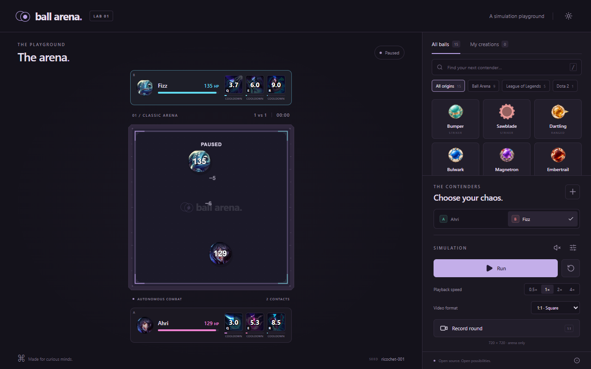

# Ball Arena Web

An open-source browser simulator based on the ball-versus-ball arena in the sibling Unity project. Choose characters, customize their appearance and up to three skills, watch automatic battles, and download an arena recording.

**Status: alpha, v0.3.0.** Runs locally and builds to static files. Website deployment is future work.

[](https://github.com/hey0x3/ball-arena-web/actions/workflows/ci.yml)



[Preview a decoded 9:16 recording frame](docs/portrait-preview.png)

## Run locally

Requires Node 22.12+ (Node 24 recommended).

```sh
npm ci
npm run dev
```

Open the Local URL printed by Vite. Bumper versus Sawblade waits in the arena. Choose contender A or B, select characters, set their starting directions, then click **Run**. Customize makes a local editable copy of a built-in ball. Loading, resetting, changing setup, and closing the editor never start the simulation.

```sh
npm test
npm run build
npm run test:e2e
```

Browser tests use installed Google Chrome locally. On CI they use Playwright Chromium (`npx playwright install --with-deps chromium`). The build produces static files in `dist/`. `npm run preview` serves that build for inspection.

## Product

- The arena fills the main screen; a right sidebar contains characters and customization.
- The contender heading and A/B selector sit above Run in the bottom controls area. Filter the roster by origin: Ball Arena, League of Legends, Dota 2, or origins supplied by community characters. Search and My creations work with these filters.
- The desktop workspace stays side by side at every window width. Below 960 px it scrolls horizontally; widening the window shows the full workspace. The 9:16 option changes exported videos only.
- Contender B's health sits above the arena; contender A's health sits below. Simulation settings includes a saved **Show health on characters** toggle.
- Both health panels are compact strips: portrait, HP and up to three skill icons with radial cooldown sweeps, timer/charge values and phase labels. Hover, focus or click an icon for its full name, live state and mechanics; Escape closes the details. League and Dota characters use their official skill icons; other mechanics have matching symbols. Portrait recordings use the same compact readouts and keep the full 720px arena.
- The arena floor carries a subtle centered **ball arena.** logo watermark in both themes and both recording formats.
- Fifteen included characters: Bumper, Sawblade, Dartling, Bulwark, Magnetron, Embertrail, Prism, Meteorion, Mallet, Aatrox, Ekko, Ahri, Caitlyn, Fizz, and Pudge.
- Aatrox uses Q/W/R and Ekko uses Q/E/R, with the supplied portraits, distinct effects and live skill readouts. These are fan adaptations with arena-specific tuning; see the [mechanics and artwork credits](docs/LEAGUE_CHARACTERS.md).
- Ahri uses Q/E/R (returning orb, charm, three spirit dashes), Caitlyn Q/W/R (rifle, armed traps/headshots, aimed ultimate), and Fizz Q/E/R (dash-through, untargetable trident hop, delayed shark). Their League category, editor settings and portraits work in both recording formats. [Ability gallery](docs/league-expansion-abilities.png).
- Pudge uses Meat Hook, Rot and Dismember, with a reeling hook/chain, toxic cloud, channeled jaws and damage-based healing. See the [Dota mechanics and artwork credits](docs/DOTA_CHARACTERS.md).
- Grab an arrow tip beside either ball in the arena and drag it with the mouse to set its starting direction. The arrows stay attached to their balls and update as you drag. Directions persist locally and are included in setup snapshots. Run starts or resumes; Reset returns to the starting positions and lets you aim again. Focused arrows also support keyboard arrow keys.
- Balls move and use their skills automatically. Visitors configure simulations.
- Each character has zero to three skills, including passive skills.
- Visitors can create, import, export, and save custom characters locally.
- Contributors and their AI agents can add characters and mechanics through pull requests.
- **Record round** prepares the next recording and waits for **Run**, which starts both capture and the fresh round using the selected directions. The completed video downloads automatically. Choose **1:1 Square** (720×720 arena) or **9:16 Short-form** (720×1280 with the full arena and both health panels). On-character health follows the display toggle in both formats.

## Add your own ball

You can create a ball in the sidebar, customize its artwork, stats, and up to **three skills**, upload optional PNG/WebP skill icons, then export a portable character pack. Import a pack to try it in your browser. Icons travel with the pack and older packs use default symbols.

To contribute a ball to the shared catalog:

1. Fork this repository and copy [the starter character](templates/character/character.json) to `content/characters/<your-ball>/character.json`.
2. Set a unique namespaced ID, choose zero to three skills, and add optional artwork with its source and license. Set `origin` to the character's game or universe; new origins automatically become roster categories. New character folders are discovered automatically.
3. Run `npm run validate:content`, `npm test`, and `npm run build`, then open a pull request. Include a screenshot or recording and explain how the ball works.

Your AI agent can do this too: use the [copyable agent task and contribution guide](CONTRIBUTING.md#ai-agent-handoff-template). New mechanics can be contributed as TypeScript skills. Browser imports stay local; accepted pull requests enter the shared catalog for a future site deployment.

## Stack

TypeScript, React, Vite, PixiJS for rendering, Planck.js for physics, and browser recording APIs. The first version runs entirely in the browser and builds to static files.

## Documentation

- [Product, architecture, and implementation plan](docs/PLAN.md)
- [Unity reference and parity checklist](docs/UNITY_REFERENCE.md)
- [Contributor and AI-agent workflow](CONTRIBUTING.md)
- [Instructions for coding agents](AGENTS.md)
- [Implemented features, checks, and remaining work](docs/IMPLEMENTATION.md)
- [Unity character behavior audit and parity checks](docs/UNITY_PARITY.md)
- [Character schema](schemas/character.v1.schema.json) and [starter character](templates/character/character.json)

The nine base characters use the Unity project's approved sprites, base parameters, and audited activation/combat rules. See the parity reference for the source details and controlled checks. Planck and Unity can produce different trajectories; campaign progression and higher mastery upgrades are outside the base simulator. Recording has been verified in desktop Chrome; other browsers need their own checks.

## Repository and licensing

This is independent of the enclosing Unity repository and runs from this checkout alone. Reference paths in the Unity notes are development context, not runtime dependencies.

Code and documentation use the [MIT license](LICENSE). The original BallGame character sprites supplied by the project owner are copied unmodified, with source paths and hashes in the [Unity audit](docs/unity-audit.json). Other contributed media declares its own license and credits.

The supplied Aatrox/Ekko portraits, bundled Ahri/Caitlyn/Fizz portraits and League of Legends characters belong to Riot Games and are excluded from the MIT license. See [the fan-content attribution](docs/LEAGUE_CHARACTERS.md#artwork-and-attribution).

Pudge, Dota 2 and the bundled official Pudge portrait belong to Valve Corporation. The portrait is excluded from MIT; see [the Valve artwork attribution](docs/DOTA_CHARACTERS.md#artwork-and-attribution).
